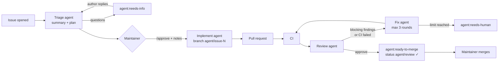

# Agent workflow: issue → plan → approval → pull request → review → merge

Claude agents run in GitHub Actions on this repository. They triage issues, build what the maintainer
approves, review every pull request, and fix what the review finds. **Only the maintainer merges.**
The rules every agent follows are in [CLAUDE.md](../CLAUDE.md).



## The agents

| Workflow | Agent | Starts on | Can write |
| --- | --- | --- | --- |
| [`agent-triage.yml`](../.github/workflows/agent-triage.yml) | Triage | a new or reopened issue; `/triage`; the author replying while `agent:needs-info` | nothing. It returns JSON; the workflow posts one "Agent triage" comment and labels |
| [`agent-implement.yml`](../.github/workflows/agent-implement.yml) | Implement | `/approve` on an issue, the label `agent:approved`, or a manual run | the branch `agent/issue-N`, the pull request, comments |
| [`agent-pr.yml`](../.github/workflows/agent-pr.yml) | Review | every non-draft pull request from this repository (opened, pushed to, reopened, ready); `/review` | inline review comments only. The workflow posts one "Agent review" comment, a label and the `agent/review` status |
| [`agent-pr.yml`](../.github/workflows/agent-pr.yml) | Fix | a review that asks for changes on an `agent/` branch or a pull request labelled `agent:autofix`; `/fix` | that pull request's branch, comments |
| [`claude.yml`](../.github/workflows/claude.yml) | On demand | `@claude` in a comment or review | a `claude/...` branch, or the pull request's branch |

### Commands (owner, members and collaborators only)

| Where | Comment | Effect |
| --- | --- | --- |
| Issue | `/approve` *optional notes* | The implement agent builds the triage plan. Notes override the plan |
| Issue | `/triage` | Triage again, for example after the issue was edited |
| Pull request | `/review` *optional notes* | Review the current head commit again |
| Pull request | `/fix` *optional notes* | Fix the latest review's findings, on any pull request from this repository and past the round limit |
| Anywhere | `@claude` *request* | Ask a question or for a change |

Every agent can also be started from the Actions tab (**Run workflow**) or from a terminal, which is
how a local or cloud Claude Code session hands work to them:

```sh
gh workflow run agent-implement.yml -f issue=12 -f notes="Keep the old shortcut working"
gh workflow run agent-pr.yml -f pr=34 -f mode=review
gh workflow run agent-pr.yml -f pr=34 -f mode=fix
gh workflow run agent-triage.yml -f issue=12
```

### What "ready to merge" means

The review agent approved (no blocker or major finding) **and** every other check on that exact commit
passed. The workflow, not the model, makes this call: failing CI or a blocking finding always gives
"changes requested". Then:

- the label `agent:ready-to-merge` is set;
- the commit status `agent/review` is green;
- the "Agent review" comment says so.

The maintainer merges with a merge commit. Each new push starts CI and the review again and replaces
the status.

### Labels

The workflows set the labels; agents and people can read them to see where work stands. The table is
in [CLAUDE.md](../CLAUDE.md#agent-labels). `scripts/agent_labels.sh` creates them.

### Settings (repository variables, all optional)

| Variable | Default | Meaning |
| --- | --- | --- |
| `AGENT_MODEL` | `claude-opus-5-5` | Model for the implement, review, fix and `@claude` agents |
| `AGENT_TRIAGE_MODEL` | `claude-sonnet-5-5` | Model for triage |
| `AGENT_MAX_FIX_ROUNDS` | `3` | Automatic fix rounds per pull request before `agent:needs-human` |

## One-time setup

1. **Install the Claude GitHub App** on this repository: https://github.com/apps/claude. The agents
   push and open pull requests as `claude[bot]` with its short-lived token. Pushes made with a
   workflow's own `GITHUB_TOKEN` would not start CI or the review.
2. **Add the Claude credential** as a repository secret (Settings › Secrets and variables › Actions):
   - with a Claude Pro or Max plan: run `claude setup-token` and save the token as
     `CLAUDE_CODE_OAUTH_TOKEN`;
   - or with an API key from console.anthropic.com: save it as `ANTHROPIC_API_KEY`.
3. **Create the labels:** `scripts/agent_labels.sh`.
4. **Protect `main`** (Settings › Branches): require a pull request, require the CI checks and
   `agent/review`, and block force-pushes. This is what stops an agent from merging or pushing to
   `main`, whatever it is told.

The workflows only run from `main`: the Claude action refuses to run a workflow file that differs from
the default branch's copy. So a pull request cannot change what the agents may do for itself.

## Security model

This is a public repository, so anyone can open an issue or a pull request.

- **Triage** reads text from anyone. It runs with no write tools and only this job's `GITHUB_TOKEN`
  (`contents: read`, `issues: write`). Its JSON answer is posted by a script that also defuses
  @-mentions.
- **Nothing is built without the maintainer.** The implement agent starts only on `/approve` or the
  `agent:approved` label from someone with write access. Read the triage plan before approving: the
  agent follows it.
- **Fork pull requests** get no secrets on the `pull_request` event, so they are not reviewed
  automatically. `/review` reviews them with the fork's files in a separate folder, read-only, and the
  fix agent never runs on them.
- **Agents cannot merge.** The review agent has read-only tools. `gh pr merge` and `gh api` are blocked
  for the agents that write, and the Claude GitHub App cannot change `.github/workflows/`. Branch
  protection on `main` is the hard limit: without it, an agent with a push token could reach `main`.
- **Tool lists are a guard rail, not a sandbox.** The implement and fix agents run the project's tests,
  so they execute the code they write. Their limits are the token's scope, branch protection and your
  approval of the plan.
- Comments from anyone other than the maintainer or a collaborator are data, not instructions, for
  every agent (CLAUDE.md).

## Costs and limits

- GitHub Actions minutes are free on a public repository. The review job waits for CI (up to 75
  minutes) before it reviews, so that it can see the results.
- Claude usage is billed to the credential in step 2: the plan's usage limits, or API tokens. Opus
  reviews and implementations cost the most. Set `AGENT_MODEL` to a Sonnet model to spend less.
- Each pull request gets at most `AGENT_MAX_FIX_ROUNDS` automatic fix rounds. `/fix` always runs.
